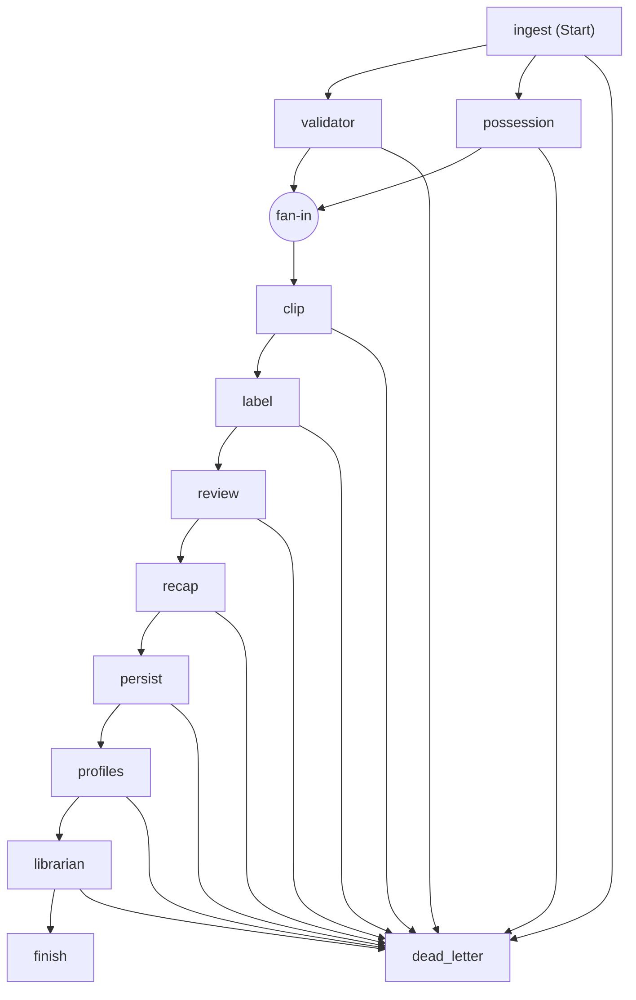
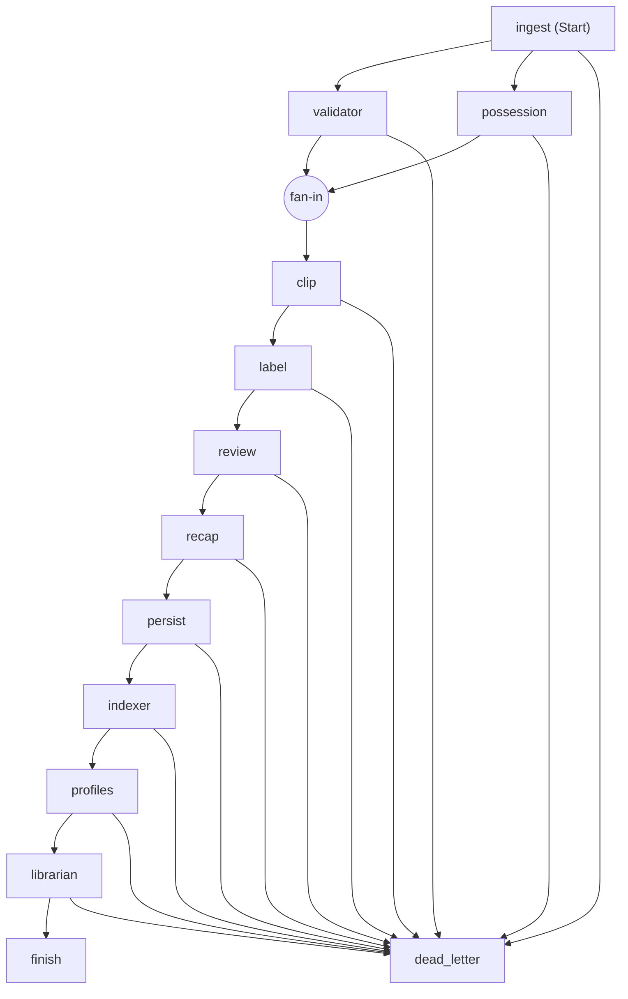

# Regista agent workflow (Microsoft Agent Framework)

Generated by `python -m regista.agents --graph docs/workflow.md`.

The graph above is the default local pipeline. The `indexer` node (Azure AI Search) is added after `persist` only when
`REGISTA_SEARCH_ENDPOINT` is set and the cloud agents are used (`--cloud` with the `.env` that `infra/provision.sh` writes, and uploads on the live app). With it, the graph is:

The second graph was generated from the same `WorkflowPipeline.mermaid()` with the agents from
`regista.cloud.agents_for(CloudConfig(search_endpoint=...))`; building it contacts no Azure service.
`--graph docs/workflow.md` rewrites this file with the first graph only.

`recap` is the Recap agent (`regista.recap.RecapAgent`): after the review, it writes `recap.json` next to the match, a
headline and short paragraphs whose every sentence cites a clip or an event, and the recap reel. With the cloud agents a
Foundry model writes it (`FoundryRecapAgent`), checked sentence by sentence, with the rules recap as the fallback.

`profiles` is the Profile agent (`ProfileRefreshExecutor`): after the match is persisted, it refreshes the Scout view's
profiles of the league players the match speaks for (global player ids on its team sheet, or confirmed "that's me"
claims, `regista.season.claims`) and records which in the trace; a match that speaks for nobody passes straight through.
Confirming a claim in the Studio runs this workflow on the claimed match (`POST /api/claims/{id}/decision`).
